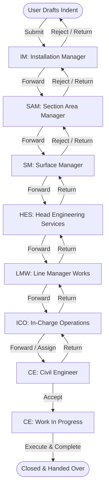

# Civil Indent Portal

An enterprise-grade requisition, workflow tracking, and lifecycle management system designed for civil engineering maintenance operations, plant installations, and administrative multi-tier approvals.

---

## Table of Contents

- [Overview](#overview)
- [Key Features](#key-features)
- [Workflow & Role Architecture](#workflow--role-architecture)
- [Technology Stack](#technology-stack)
- [Data Model & Schema](#data-model--schema)
- [Quick Start with Docker](#quick-start-with-docker)
- [Local Development Setup](#local-development-setup)
- [Pre-Seeded Accounts & Role Directory](#pre-seeded-accounts--role-directory)
- [Testing & Quality Assurance](#testing--quality-assurance)
- [Security & Authorization Policies](#security--authorization-policies)
- [Design System & UI](#design-system--ui)

---

## Overview

The **Civil Indent Portal** streamlines the formal lifecycle of civil work requisitions across industrial assets, plant facilities, and operational areas. It enforces strict sequential approvals, audit traceability, single/multi-holder role rules, execution tracking, and access-controlled document attachments.

Each indent progresses through an immutable chronological audit trail detailing **who** acted, **what** role they held at that timestamp, **why** actions were taken (mandatory rejection/return remarks), and **when** work transitions occurred.

---

## Key Features

- **Lifecycle Management**: Draft saving, review forwarding, returns, rejections, in-progress work tracking, and final completion handover.
- **Strict Workflow Sequencing**: Enforces linear forwarding along the organizational hierarchy (`USER` &rarr; `IM` &rarr; `SAM` &rarr; `SM` &rarr; `HES` &rarr; `LMW` &rarr; `ICO` &rarr; `CE`).
- **Dynamic Recipient Search**: Instant AJAX-powered recipient selector with smart role filtering, CPF search, and installation/area scope auto-matching.
- **Return & Rejection Safeguards**:
  - Rejection flag restricted exclusively to authorized operational tiers (`IM`, `SAM`, `SM`) with mandatory justification.
  - Return capability allowing indents to be returned directly to any earlier participant in the workflow history.
- **Civil Execution Panel**: Dedicated on-site execution controls (`Accept`, `Start Work`, `Complete & Close`) reserved for assigned Civil Engineers holding the indent.
- **Concurrency-Safe Auto-Numbering**: Issues standardized identifiers (`CI-YYYY-XXXX`) using database row-locking (`lockForUpdate()`) to prevent race conditions.
- **Secure File Storage**: Supports multiple file uploads (drawings, CAD files, site photos, PDFs, spreadsheets up to 100 MB per file) stored securely on private disks with authorized download streaming.
- **Comprehensive Audit Trail**: Complete timeline showing all past movements, actor CPF, role at the time of movement, action, and decision remarks.
- **Administrative Control Center**: User-role assignments, operational area/installation master data management, and immutable audit logging.

---

## Workflow & Role Architecture

### 1. Organizational Role Hierarchy

| Role Code | Role Name | Operational Scope | Multi-Holder | Functional Description |
| :--- | :--- | :--- | :---: | :--- |
| **USER** | Standard User | Global | Yes | Any registered employee; can raise and draft indents. |
| **IM** | Installation Manager | Installation | No | First reviewer at the target plant/installation site. |
| **SAM** | Section Area Manager | Area | No | Area-level engineering manager oversight. |
| **SM** | Surface Manager | Area | No | Senior operational clearance across the asset area. |
| **HES** | Head Engineering Services | Global | No | Centralized engineering authority approval. |
| **LMW** | Line Manager (Works) | Global | No | Civil works budget and administrative clearance. |
| **ICO** | In-Charge Operations | Installation | No | Plant operations site clearance for physical work. |
| **CE** | Civil Engineer | Installation | Yes | Assigned site engineer responsible for physical execution. |
| **ADMIN** | System Administrator | Global | Yes | Master data, user-role governance, and audit logs. |

### 2. Workflow Transition Flow



---

## Technology Stack

- **Framework**: [Laravel 12](https://laravel.com/) (PHP 8.4)
- **Database**: [MySQL 8.0](https://www.mysql.com/) (Production/Docker), [SQLite](https://www.sqlite.org/) (Testing)
- **Cache & Queues**: [Redis 7.2](https://redis.io/)
- **Web Server**: Nginx + PHP-FPM via `serversideup/php` container
- **Frontend Architecture**: Blade Views, Reusable Blade Components, Vanilla JavaScript
- **Styling**: Vanilla CSS Design System with accessible WCAG AAA compliant color tokens
- **Testing**: PHPUnit / Pest Test Suite with 80+ automated feature and unit tests

---

## Data Model & Schema

```
Users ──────────────────< Role Assignments >───────────── Roles
  │                                │
  │ creates / holds                │ scopes to Area / Installation
  ▼                                ▼
Indents ──────────────< Installations >──────── Areas
  │
  ├───< Movements (Workflow audit history)
  ├───< Indent Participants (Access control)
  ├───< Attachments (Private files)
  └───  Indent Sequences (Atomic counter)
```

### Core Entities

- **`indents`**: Work title, description, category, target installation, priority (`Low`, `Medium`, `High`, `Urgent`), required-by date, justification, status (`Open`, `Assigned`, `InProgress`, `Closed`), draft flag, rejection flag, creator CPF, current holder CPF.
- **`movements`**: Transition history tracking `indent_id`, `from` CPF, `from_role`, `to` CPF, `to_role`, `action`, `is_rejected`, and `remark`.
- **`indent_participants`**: Record of every CPF who has created, received, or forwarded the indent (controls view authorization).
- **`attachments`**: Files uploaded during drafting or review movements, stored on private disks with sanitized naming and metadata.
- **`role_assignments`**: Binds a user CPF to a role with optional `installation_id` or `area_id` scoping.
- **`audit_logs`**: Chronological log of administrative actions (role grants and revocations).

---

## Quick Start with Docker

The project includes an optimized Docker Compose stack for instant local deployment.

### 1. Clone Repository & Setup Environment

```bash
git clone https://github.com/rathodromit-51/Civil-Indent-Portal.git
cd Civil-Indent-Portal
cp .env.example .env
```

### 2. Start Containers

```bash
docker compose up -d --build
```

### 3. Initialize Application

Run database migrations, seeders, and storage configuration inside the container:

```bash
docker compose exec app php artisan migrate --seed
docker compose exec app php artisan storage:link
```

### 4. Access the Portal

- **Web Application**: [http://localhost:8000](http://localhost:8000)
- **Database Management (optional)**: [http://localhost:8081](http://localhost:8081) (`--profile tools`)

---

## Local Development Setup

If running without Docker:

### Prerequisites

- PHP >= 8.2 with PDO, cURL, OpenSSL, MBString, GD extensions
- Composer 2.x
- MySQL 8.0 or SQLite
- Node.js (optional, frontend assets are pure CSS)

### Installation Steps

```bash
# 1. Install Composer dependencies
cd src
composer install

# 2. Configure environment
cp .env.example .env
php artisan key:generate

# 3. Configure Database in .env (MySQL or SQLite)
# Example SQLite:
# DB_CONNECTION=sqlite
# DB_DATABASE=/path/to/database.sqlite

# 4. Run Migrations & Seeders
php artisan migrate:fresh --seed

# 5. Link Storage Disk
php artisan storage:link

# 6. Start Local Server
php artisan serve
```

---

## Pre-Seeded Accounts & Role Directory

In development mode (`AUTH_MODE=dev`), the portal authenticates via `DevAuthenticator`. Any seeded CPF logs in using the default password: **`secret123`**.

| CPF | Name | Active Role | Scope | Designation |
| :--- | :--- | :--- | :--- | :--- |
| `ADMIN001` | Super Admin | **ADMIN** | Organization-wide | Head of Systems Administration |
| `USER001` | Ramesh Sharma | **USER** | General | Assistant Engineer (Civil) |
| `USER002` | Suresh Kumar | **USER** | General | Junior Engineer (Maintenance) |
| `USER003` | Priya Patel | **USER** | General | Operations Coordinator |
| `IM001` | Vikram Mehta | **IM** | Vadodara Plant 1 | Installation Manager (Site Head) |
| `SAM001` | Anita Desai | **SAM** | Vadodara Asset | Section Area Manager |
| `SM001` | Rajesh Nair | **SM** | Vadodara Asset | Surface Manager |
| `HES001` | Sanjay Joshi | **HES** | Organization-wide | Head of Engineering Services |
| `LMW001` | Manisha Rao | **LMW** | Organization-wide | Line Manager (Works) |
| `ICO001` | Arvind Singh | **ICO** | Vadodara Plant 1 | In-Charge Operations |
| `CE001` | Deepak Patel | **CE** | Vadodara Plant 1 | Civil Engineer (Site Lead) |

---

## Testing & Quality Assurance

The codebase features comprehensive feature and unit test coverage verifying business logic, authorization policies, single-holder constraints, strict workflow sequencing, query optimization, and UI rendering.

```bash
# Run all tests
php artisan test

# Run specific test suites
php artisan test --filter=IndentForwardTest
php artisan test --filter=StrictWorkflowTest
php artisan test --filter=IndentDetailAndTimelineTest
php artisan test --filter=UserRoleTest
```

### Key Tested Scenarios

- **FRIND-04 Compliance**: Verifies that submitted indents become immutable to edits or deletion by any party.
- **Strict Role Sequence**: Validates forward actions follow the mandatory chain of command and prevents role jumping.
- **Access Control & Privacy**: Verifies that strangers receive HTTP `403 Forbidden` while all past participants can view the indent.
- **N+1 Prevention**: Verified with query logging to guarantee page queries remain strictly bounded (&le; 25 total database queries per full page render).
- **Audit Logs**: Confirms every role assignment and revocation is captured in audit logs with actor, recipient, and scope details.

---

## Security & Authorization Policies

The application adheres to defensive design standards:

1. **Gate & Policy Enforcement**:
   - `IndentPolicy@view`: Restricted to the creator, current holder, or any recorded participant in `indent_participants`.
   - `IndentPolicy@update`: Restricted strictly to drafts owned by the authenticated creator.
   - `IndentPolicy@forward`: Restricted strictly to the current active holder.
   - `IndentPolicy@updateStatus`: Restricted exclusively to assigned Civil Engineers (`CE`) holding the indent.
   - `RolePolicy`: Prevents administrators from modifying or deleting their own roles.
2. **Single-Holder Role Verification**: Prevents assigning single-holder roles (e.g., `IM`, `SAM`, `SM`) if another active user currently holds that role within the target scope.
3. **Private File Disk**: Uploaded attachments are never exposed in public directories; downloads are authorized through authenticated streaming endpoints with validated MIME types.

---

## Design System & UI

The portal features an enterprise design system adhering to strict corporate aesthetic standards:

- **Icon & Emoji-Free Interface**: Clean, professional typography with zero casual emojis or decorative icons.
- **Accessible Palette**: Standardized Slate neutrals (`#0f172a`, `#64748b`, `#e2e8f0`, `#f8fafc`) paired with WCAG AAA compliant semantic tints:
  - **Open**: Emerald (`#047857` on `#ecfdf5`)
  - **Assigned / Forward**: Blue (`#1d4ed8` on `#eff6ff`)
  - **In Progress**: Purple (`#6b21a8` on `#f3e8ff`)
  - **Closed**: Slate (`#475569` on `#f1f5f9`)
  - **Draft**: Amber (`#92400e` on `#fef3c7`)
  - **Rejected / Urgent**: Red (`#b91c1c` on `#fee2e2`)
- **Responsive Layout**: Fluid flex and grid layouts optimized for desktop workstations, tablets, and field mobile devices.

---

## License

This project is proprietary and confidential. Developed for organizational civil maintenance requisition and workflow governance.
