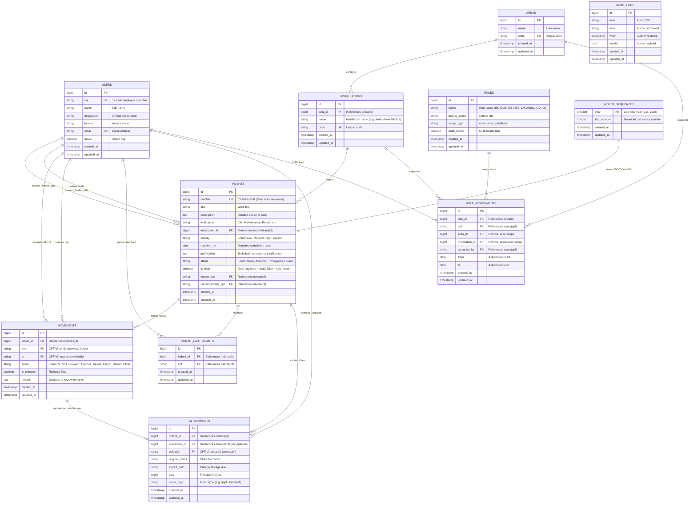

# Civil Indent Portal — Entity Relationship Diagram (ERD) & Schema Specification

This document provides the architectural data model and Entity Relationship Diagram (ERD) sketch for the **Civil Indent Portal** (Phase P1: Indents, Movements, Participants, Attachments, and Auto-Numbering).

---

## 1. Mermaid Entity-Relationship Diagram (ERD)



---

## 2. Data Dictionary

### 2.1 `indents` Table
Represents civil work indents and requisitions.

| Column | Type | Nullable | Default | Description & Constraints |
|---|---|---|---|---|
| `id` | `BIGINT UNSIGNED` | No | Auto-increment | Primary key |
| `number` | `VARCHAR(30)` | No | — | Unique auto-generated identifier (e.g. `CI-2026-0001`) |
| `title` | `VARCHAR(255)` | No | — | Brief title of civil work |
| `description` | `TEXT` | Yes | `NULL` | Detailed technical specifications of the work |
| `work_type` | `VARCHAR(100)` | No | — | Category of civil work (e.g. Civil Maintenance, Structural Repair) |
| `installation_id` | `BIGINT UNSIGNED` | No | — | Foreign key to `installations.id` (cascade on delete) |
| `priority` | `VARCHAR(50)` | No | `'Medium'` | Cast to `App\Enums\IndentPriority` (`Low`, `Medium`, `High`, `Urgent`) |
| `required_by` | `DATE` | No | — | Target completion / execution date |
| `justification` | `TEXT` | Yes | `NULL` | Operational / structural justification for requisition |
| `status` | `VARCHAR(50)` | No | `'Open'` | PHP Backed Enum: `Open`, `Assigned`, `InProgress`, `Closed` |
| `is_draft` | `BOOLEAN` | No | `false` | Draft flag (`true` = draft indent, `false` = active workflow) |
| `creator_cpf` | `VARCHAR(14)` | No | — | CPF of creator (indexed; references `users.cpf`) |
| `current_holder_cpf`| `VARCHAR(14)` | Yes | `NULL` | CPF of current actor in workflow (indexed; references `users.cpf`) |
| `created_at` | `TIMESTAMP` | Yes | `NULL` | Creation timestamp |
| `updated_at` | `TIMESTAMP` | Yes | `NULL` | Last update timestamp |

### 2.2 `indent_sequences` Table
Maintains safe, gap-free, monotonic sequence counters per year to guarantee zero collision in indent numbering under concurrent load.

| Column | Type | Nullable | Default | Description & Constraints |
|---|---|---|---|---|
| `year` | `SMALLINT UNSIGNED` | No | — | Primary key (e.g. `2026`) |
| `last_number` | `INT UNSIGNED` | No | `0` | Last issued sequence number for that year |
| `created_at` | `TIMESTAMP` | Yes | `NULL` | Record creation timestamp |
| `updated_at` | `TIMESTAMP` | Yes | `NULL` | Record update timestamp |

### 2.3 `movements` Table
Audit trail of all workflow transitions and approvals across the role hierarchy.

| Column | Type | Nullable | Default | Description & Constraints |
|---|---|---|---|---|
| `id` | `BIGINT UNSIGNED` | No | Auto-increment | Primary key |
| `indent_id` | `BIGINT UNSIGNED` | No | — | Foreign key to `indents.id` (cascade on delete) |
| `from` | `VARCHAR(14)` | Yes | `NULL` | CPF of previous holder / actor (indexed) |
| `to` | `VARCHAR(14)` | Yes | `NULL` | CPF of next designated holder (indexed) |
| `action` | `VARCHAR(50)` | No | — | Action taken (Submit, Forward, Approve, Reject, Assign, Return, Close) |
| `is_rejected` | `BOOLEAN` | No | `false` | Rejected flag |
| `remark` | `TEXT` | Yes | `NULL` | Comments / remarks provided by actor |
| `created_at` | `TIMESTAMP` | Yes | `NULL` | Transition timestamp |
| `updated_at` | `TIMESTAMP` | Yes | `NULL` | Record update timestamp |

### 2.4 `indent_participants` Table
Associates relevant stakeholders and observers to an indent for notifications, access, and collaboration.

| Column | Type | Nullable | Default | Description & Constraints |
|---|---|---|---|---|
| `id` | `BIGINT UNSIGNED` | No | Auto-increment | Primary key |
| `indent_id` | `BIGINT UNSIGNED` | No | — | Foreign key to `indents.id` (cascade on delete) |
| `cpf` | `VARCHAR(14)` | No | — | Participant employee CPF (indexed) |
| `created_at` | `TIMESTAMP` | Yes | `NULL` | Added timestamp |
| `updated_at` | `TIMESTAMP` | Yes | `NULL` | Record update timestamp |

**Indexes & Constraints**:
- `UNIQUE (indent_id, cpf)`: Prevents duplicate participant associations on the same indent.

### 2.5 `attachments` Table
File uploads linked to an indent or a specific workflow movement / comment.

| Column | Type | Nullable | Default | Description & Constraints |
|---|---|---|---|---|
| `id` | `BIGINT UNSIGNED` | No | Auto-increment | Primary key |
| `indent_id` | `BIGINT UNSIGNED` | No | — | Foreign key to `indents.id` (cascade on delete) |
| `movement_id` | `BIGINT UNSIGNED` | Yes | `NULL` | Optional foreign key to `movements.id` (null on delete) |
| `uploader` | `VARCHAR(14)` | No | — | CPF of employee who uploaded the file (indexed) |
| `original_name` | `VARCHAR(255)` | No | — | Original client file name (e.g. `foundation_plan.pdf`) |
| `stored_path` | `VARCHAR(500)` | No | — | Relative path on storage disk |
| `size` | `BIGINT UNSIGNED` | No | — | File size in bytes |
| `mime_type` | `VARCHAR(100)` | Yes | `NULL` | File MIME type (e.g. `application/pdf`) |
| `created_at` | `TIMESTAMP` | Yes | `NULL` | Upload timestamp |
| `updated_at` | `TIMESTAMP` | Yes | `NULL` | Record update timestamp |

---

## 3. PHP Backed Enums

### 3.1 `App\Enums\IndentStatus`
PHP 8 backed string enum:
```php
namespace App\Enums;

enum IndentStatus: string
{
    case OPEN = 'Open';
    case ASSIGNED = 'Assigned';
    case IN_PROGRESS = 'InProgress';
    case CLOSED = 'Closed';
}
```

### 3.2 `App\Enums\IndentPriority`
```php
namespace App\Enums;

enum IndentPriority: string
{
    case LOW = 'Low';
    case MEDIUM = 'Medium';
    case HIGH = 'High';
    case URGENT = 'Urgent';
}
```

### 3.3 `App\Enums\MovementAction`
```php
namespace App\Enums;

enum MovementAction: string
{
    case SUBMIT = 'Submit';
    case FORWARD = 'Forward';
    case APPROVE = 'Approve';
    case REJECT = 'Reject';
    case ASSIGN = 'Assign';
    case RETURN = 'Return';
    case CLOSE = 'Close';
    case COMMENT = 'Comment';
}
```

---

## 4. Concurrency-Safe Auto Numbering (`CI-YYYY-XXXX`)

To satisfy the requirement that indent numbers like `CI-2026-0001` are generated safely with zero duplicates even when two concurrent requests arrive at the exact same millisecond:

```
[Request A] ──┐
              ├──► [DB::transaction] ──► [lockForUpdate on year=2026] ──► [last_number + 1] ──► CI-2026-0001
[Request B] ──┘         (Queued / Locked until Request A commits)     ──► [last_number + 2] ──► CI-2026-0002
```

1. **Dedicated Atomic Sequence Table (`indent_sequences`)**:
   Tracks the current year counter.
2. **Pessimistic Row Lock (`lockForUpdate()`) inside `DB::transaction()`**:
   Acquires an exclusive row-level lock on the `indent_sequences` record for that year. Any concurrent transaction waits until the active transaction commits.
3. **Database Level Hard Constraint**:
   `$table->string('number', 30)->unique();` guarantees data-integrity at the database engine level.

---

## 5. Verification via Tinker

To verify model and factory functionality, run:

```bash
php artisan tinker --execute="dump(App\Models\Indent::factory()->withMovement()->create()->load('movements')->toArray());"
```

Expected output:
- Auto-assigned sequential identifier: `CI-2026-0001`
- Backed enum status: `Open`
- Associated `movements` record created with `from`, `to`, `action` (`Submit`), `is_rejected` (`false`), and `remark`.
